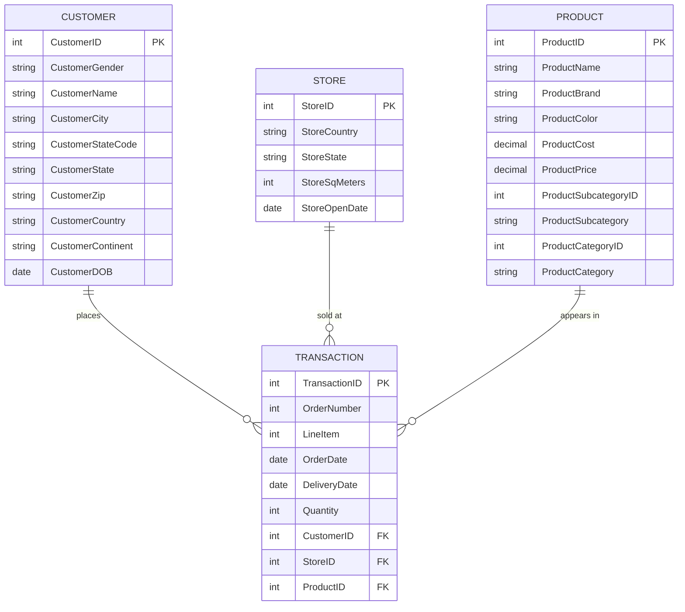

# Data Normalization: Retail Sales Dataset

An Excel project that takes a flat, denormalized retail sales table and splits it into a normalized relational structure (one fact table and three dimension tables). The tables are loaded into the Excel Data Model with Power Query, and a PivotTable is built on top of them.

> **File:** [`Data Normalization.xlsx`](Data%20Normalization.xlsx)

---

## Table of Contents

1. [Project Overview](#project-overview)
2. [Workbook Structure](#workbook-structure)
3. [Schema](#schema)
4. [Methodology](#methodology)
5. [Validation Results](#validation-results)
6. [Pivot Table Output](#pivot-table-output)
7. [Data Quality Observations](#data-quality-observations)
8. [Normalization Level and Possible Improvements](#normalization-level-and-possible-improvements)
9. [How to Use](#how-to-use)
10. [Tools](#tools)
11. [Author](#author)

---

## Project Overview

The source data is a single wide table of **62,884 transaction lines across 31 columns**. Every row repeats the customer, store and product details, which wastes space and makes updates error-prone. For example, changing a product price means editing thousands of rows.

This project:

- Separates the repeated attributes into dedicated **Customer**, **Product** and **Store** tables.
- Keeps a lean **Transaction** (fact) table that references them through ID keys.
- Loads all four tables into the Excel **Data Model** via Power Query.
- Builds a **PivotTable** from the model to show that the normalized structure still supports analysis.
- Checks that nothing was lost or changed in the split.

## Workbook Structure

| Sheet | Rows | Columns | Description |
|---|---:|---:|---|
| `Data` | 62,884 | 31 | Original flat (denormalized) table, kept for reference |
| `TransactionID` | 62,884 | 9 | **Fact table**: order, line item, dates, quantity and foreign keys |
| `CustomerID` | 11,887 | 10 | **Customer dimension**: name, gender, location, date of birth |
| `ProductID` | 2,492 | 10 | **Product dimension**: name, brand, colour, cost, price, category hierarchy |
| `StoreID` | 58 | 5 | **Store dimension**: country, state, size, open date |
| `PIVOT TABLE` | 491 states | 3 | Sum of Quantity by customer state and gender |

Each table is an Excel Table with its own Power Query connection and is loaded into the workbook's Data Model.

## Schema

This is a **star schema**: one central fact table surrounded by three dimension tables. `StoreID = 0` represents the **Online** store.

## Methodology

1. **Start with the flat table.** The `Data` sheet holds every attribute for every transaction line.
2. **Identify entities.** The columns fall into four groups: transaction, customer, product and store attributes.
3. **Assign keys.** `CustomerID`, `ProductID` and `StoreID` become primary keys in their own tables. They stay in the transaction table as foreign keys.
4. **Split into tables.** Each entity's attributes are moved to its own table, with duplicates removed. The transaction table keeps only the transaction-level fields and the three foreign keys.
5. **Load with Power Query.** Each table is imported as a query and loaded to the Data Model.
6. **Build the PivotTable** from the Data Model, with `CustomerState` on rows, `CustomerGender` on columns and Sum of `Quantity` as the value.
7. **Validate** that the split is lossless (see below).

## Validation Results

The normalized tables were checked against the original flat table:

| Check | Result |
|---|---|
| Primary keys unique in every table | Passed |
| Orphaned foreign keys (transactions pointing to a missing customer, product or store) | 0 |
| Dimension rows never used by any transaction | 0 |
| Rejoining the four tables reproduces the flat table (62,884 rows, 31 columns) | Identical |
| Pivot totals recomputed independently | All 491 states match |

The only difference found in the rejoin is on one transaction (`3660091`). In the flat table its `DeliveryDate` is a whitespace string. In the normalized table it is a proper empty date.

## Pivot Table Output

Total quantity sold by customer gender:

| Female | Male | Grand Total |
|---:|---:|---:|
| 97,694 | 100,063 | **197,757** |

Top customer states by quantity: **California** (11,295), **Texas** (7,866), **Ontario** (6,989), **New York** (6,305) and **Freistaat Bayern** (5,376).

By customer country, the **United States** leads with 106,407 units, followed by the United Kingdom (25,298), Germany (18,943), Canada (16,793), Australia (9,209), Italy (8,470), the Netherlands (7,252) and France (5,385).

Order dates run from **2016-01-01 to 2021-02-20**, and quantities per line range from 1 to 10.

## Data Quality Observations

| Issue | Detail | Suggested handling |
|---|---|---|
| Null `DeliveryDate` (79.1%) | By design: all 13,165 online orders have a delivery date and none of the in-store sales do | Treat as "not applicable", not as missing data |
| Lost leading zeros in zip codes | 503 US customers have 4-digit zips such as `5301`. The column mixes numbers and text | Store the zip as text and pad to 5 digits for US addresses |
| Garbled characters in store states | `Franche-Comté`, `La Réunion`, `Freistaat Thüringen` (a UTF-8 encoding error) | Correct to `Franche-Comté`, `La Réunion`, `Freistaat Thüringen` |
| Inconsistent city casing | About 22.6% of city names are in all caps (mostly UK and Australian) | Standardise to proper case |
| Extra spaces in names | 15 customer names contain double spaces | Trim and collapse whitespace |
| Gaps in `StoreID` | IDs 3, 7, 11, 25, 35, 46, 52, 58 and 60 are absent | Likely closed or unused stores; confirm with the source |
| `"NA"` read as null by some tools | Nine Napoli customers have state code `NA` (Naples). Excel keeps it as text, but tools like pandas treat it as missing by default | Read with `keep_default_na=False` |
| Store and customer location mismatch | Customers always shop in a store in their own country, but the store's state is unrelated to the customer's state (e.g. an Ontario customer at a Nunavut store) | Appears to be a feature of the sample data; avoid state-level store analysis |

Other checks passed: no product is priced below its cost, no delivery date precedes its order date, and no quantity is zero or negative. State codes repeat across countries (for example `IL` in both the US and France), so `CustomerStateCode` should never be used as a key on its own.

## Normalization Level and Possible Improvements

The fact table is clean. The dimension tables follow star-schema practice but are not fully 3NF:

- **Product:** `ProductSubcategoryID` determines the subcategory and category. There are 32 subcategories in 8 categories, so the category columns depend on the subcategory rather than directly on `ProductID`.
- **Customer:** state determines country, and country determines continent. These transitive dependencies are repeated on every customer row.
- **Store:** no issues.

**Next steps for a fully 3NF design:**

- Add `Category` and `Subcategory` tables and reference them from `Product`.
- Add `Country` and `State` tables and reference them from `Customer` and `Store`.
- Apply the data-quality fixes above.
- Add a `Date` table to support time-based analysis.
- Add measures such as revenue (`Quantity * ProductPrice`) and profit (`Quantity * (ProductPrice - ProductCost)`).

## How to Use

1. Download `Data Normalization.xlsx` from this folder and open it in **desktop Excel** (Windows or Microsoft 365). The Data Model and Power Query are not fully supported in Excel for the web or on Mac.
2. Review each table sheet to see the normalized structure.
3. Go to **Data > Queries & Connections** to see the four Power Query connections.
4. Go to **Data > Manage Data Model** to inspect the tables and relationships.
5. Open the `PIVOT TABLE` sheet and right-click > **Refresh** to rebuild it from the model.

## Tools

- Microsoft Excel (Tables, PivotTables)
- Power Query
- Excel Data Model (Power Pivot)
- Python (pandas), used only to validate the results independently

## Author

**Maureen**
BSc Data Science and Analytics, Jomo Kenyatta University of Agriculture and Technology (JKUAT)
GitHub: [@Maureen52](https://github.com/Maureen52)
